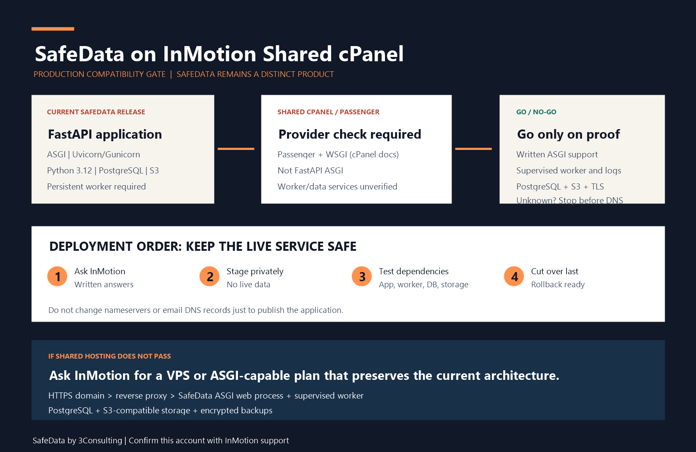
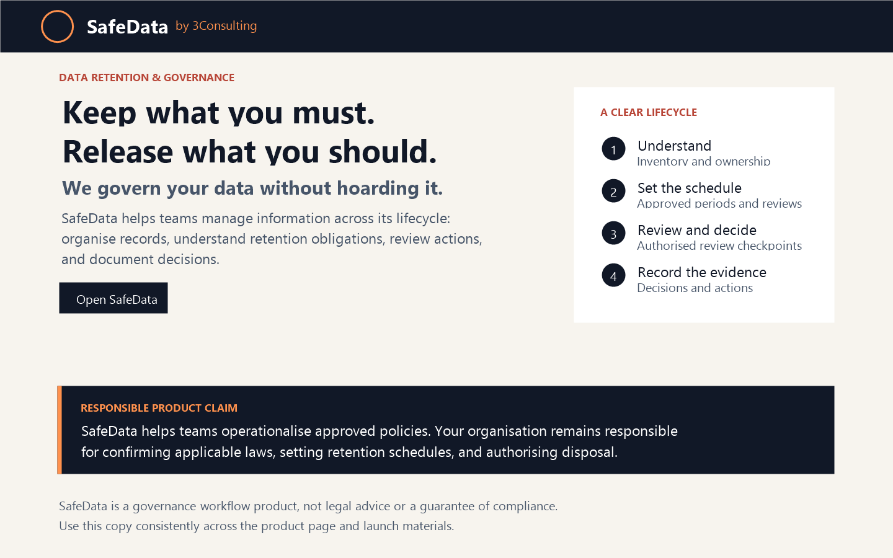

# SafeData on InMotion Shared cPanel

## Deployment decision

**Status: compatibility-first; do not publish the current application on shared cPanel until InMotion confirms the required runtime.**

SafeData is a standalone product. Its primary application is a Python 3.12 FastAPI **ASGI** service launched with Uvicorn/Gunicorn. The production configuration also requires PostgreSQL, S3-compatible object storage, encrypted backup configuration, and a separate persistent worker process.

cPanel's documented Python Application Manager uses Passenger and a `passenger_wsgi.py` WSGI entry point. WSGI and ASGI are different application interfaces. Do not point Passenger directly at `main:app`, copy a generic Flask `passenger_wsgi.py`, or install an unreviewed adapter as a workaround. The production worker also must not be omitted or run as an unmanaged background shell process.

**Go only when the hosting provider confirms every required capability below for this exact shared account. If any hard requirement is unavailable, shared cPanel is not an appropriate production target for the current SafeData release.** Ask InMotion about a VPS plan or an explicitly supported ASGI hosting option before changing the app runtime.

## Product identity and public wording

SafeData is the only product covered by this package. Do not add the 3Consulting corporate homepage or FraudGuard dashboard to the SafeData application.

### Approved product copy

**Product:** SafeData by 3Consulting  
**Primary tagline:** Keep what you must. Release what you should.  
**Supporting line:** We govern your data without hoarding it.

**Page title:** SafeData — Data Retention & Governance  
**Meta description:** A practical, accountable approach to information retention and lifecycle governance.

**Hero heading:** Keep what you must. Release what you should.  
**Hero paragraph:** SafeData helps teams manage information across its lifecycle: organise records, understand retention obligations, review actions, and document decisions.  
**Primary action:** Open SafeData  
**Secondary action:** Product overview

**Lifecycle sections**

1. **Understand** — Build a clear inventory of information assets, ownership, and the business context in which records are held.
2. **Set the schedule** — Document retention periods and review dates against your organisation's approved policies and obligations.
3. **Review and decide** — Give authorised people a checkpoint to review records before a retention or disposal action proceeds.
4. **Record the evidence** — Keep an auditable record of decisions and actions so your team can explain what happened and why.

**Governance qualification:** SafeData helps teams operationalise their approved policies. Your organisation remains responsible for confirming applicable laws, setting retention schedules, and authorising disposal. SafeData is not legal advice.

These statements describe product workflows; do not turn them into absolute claims of legal compliance, guaranteed deletion, certifications, or security outcomes unless those claims have been separately verified and approved.

## 1. Provider preflight — obtain written answers

Open an InMotion support ticket or chat while signed in to the account. Supply the short message below and wait for answers before uploading production data or changing DNS.

### Copy-and-send provider question

> I plan to deploy SafeData, a Python 3.12 FastAPI ASGI application, on my InMotion shared cPanel account. It currently starts through Uvicorn/Gunicorn and has a separate persistent Python worker (`python -m app.worker`). Production requires PostgreSQL (not SQLite), S3-compatible object storage, outbound TLS connections to those services, and configurable environment variables.
>
> Please confirm for my exact plan and server:
>
> 1. Is Python 3.12 available for cPanel applications, and can this account install the pinned packages in `retention_py/requirements.txt`, including the PostgreSQL driver and cryptography dependency?
> 2. Does the installed Passenger version support **ASGI** applications directly, or does it support WSGI only? Can InMotion support the FastAPI ASGI interface without an unapproved WSGI adapter?
> 3. Can the account run a continuously supervised second process for `python -m app.worker`, with restart-on-failure and logs? Are long-running app and worker processes permitted by this plan?
> 4. Can the app connect over TLS to an external PostgreSQL 14+ service and external S3-compatible object storage? Are outbound host/port restrictions, process, memory, CPU, request-time, or disk quotas likely to block these services?
> 5. Can cPanel configure per-application environment variables securely (not in a public file), restart both processes after deployment, provide TLS for `safedata.3consult-ng.com`, and preserve file permissions outside `public_html`?
> 6. If shared hosting does not support this exact ASGI + worker setup, which InMotion VPS/hosting plan supports Docker or supervised Uvicorn/Gunicorn plus a separate worker?
>
> Please link the applicable plan limits and confirm whether the support team will assist with this ASGI deployment.

Record ticket ID, date, plan name, server hostname, Python version, Passenger version, and the written answer. Never send credentials, tokens, private keys, live customer data, or secret values to support.

### Go / no-go matrix

| Requirement | Must be confirmed | If unavailable |
|---|---|---|
| Python 3.12 and required binary/wheel dependencies | Supported on this account | Stop; do not change dependency versions casually |
| FastAPI ASGI serving | Passenger supports ASGI or provider supplies a supported ASGI process route | Stop; WSGI compatibility is not established |
| Persistent worker | Supervised, restarted, logged worker process is permitted | Stop; do not drop scheduled jobs |
| PostgreSQL | Reachable supported production PostgreSQL service | Stop; production explicitly rejects SQLite |
| S3-compatible storage | Reachable bucket, TLS and credentials supported | Stop; production requires S3 storage |
| Secret/environment configuration | Private environment values and secure file permissions | Stop; never place secrets in the repository or public web root |
| TLS and custom domain | Certificate and correct hostname supported | Do not direct public traffic until HTTPS works |

All rows must be **confirmed** before production deployment. An unknown answer is not a pass.

## 2. Current application requirements

Review these repository files before deployment:

- `retention_py/Dockerfile` — Python 3.12 image and Gunicorn/Uvicorn startup command.
- `retention_py/requirements.txt` — pinned runtime and database dependencies.
- `retention_py/app/config.py` — startup-time production requirements and environment names.
- `retention_py/app/worker/` — scheduled jobs, worker runner, locking, and worker entry point.
- `retention_py/app/cli.py` — application migration command.
- `retention_py/render.yaml` — existing Render configuration, useful as an environment-variable inventory; it does **not** configure InMotion.

The production process requires at least:

| Setting | Purpose | Handling |
|---|---|---|
| `APP_ENV=production` | Enables production checks and secure cookie behavior | Set in the app's private environment |
| `APP_URL=https://safedata.3consult-ng.com` | Canonical HTTPS URL used in links and email | Match the confirmed SafeData hostname |
| `SECRET_KEY` | Signs application session/security material | Generate a unique random value; never copy a public example |
| `DATABASE_URL` | PostgreSQL connection | Use a dedicated production DB user and TLS where offered |
| `BACKUP_ENCRYPTION_KEY` | Encrypts application backups | Generate a valid Fernet key; keep a separate secure recovery copy |
| `STORAGE_BACKEND=s3` | Production object-storage mode | Do not switch to local disk for production |
| `S3_BUCKET`, `S3_ACCESS_KEY_ID`, `S3_SECRET_ACCESS_KEY` | S3-compatible object storage | Least privilege; use TLS; do not paste values into tickets |
| `S3_ENDPOINT_URL` and `S3_REGION` | S3-compatible endpoint configuration | Use exact provider values; region may be `auto` where provider requires it |
| `ALLOWED_HOSTS` | Host-header allowlist | Include only the SafeData public hostname and required operational hostnames |
| `TRUSTED_PROXIES` | Reverse-proxy forwarding trust | Set only if InMotion documents the proxy addresses and app needs them |
| `SMTP_HOST`, `SMTP_PORT`, `SMTP_USER`, `SMTP_PASS` | Transactional email delivery | Test verification/reset messages; use an approved sender domain |

SMTP sender/reply-to settings can also include `SMTP_FROM_EMAIL`, `SMTP_FROM_NAME`, `SMTP_SECURE`, and `SMTP_REPLY_TO`. Paystack settings, if enabled for this build, must be listed from the current source/config and configured separately in cPanel; use test credentials until checkout has passed an end-to-end test.

Production startup intentionally fails without a secret key, a valid backup-encryption key, PostgreSQL, and configured S3 credentials. Do not disable these guards to get a green page.

## 3. Safe sequence for a cPanel deployment

### Phase A — preserve the currently deployed service

1. Keep the existing Render deployment running until InMotion passes the production verification and you explicitly choose cutover.
2. Do not change nameservers or remove the existing `safedata.3consult-ng.com` DNS records yet.
3. Export a verified database backup and object-storage inventory from the current production environment. Confirm that the backup can be decrypted/restored in a controlled non-production environment.
4. Record the current application version, deployment time, database migration revision, DNS TTL, and rollback contact.
5. Do not use production data for tests on shared hosting.

### Phase B — validate account capabilities

1. Obtain the written answers in §1.
2. In cPanel, check whether **Setup Python App** or **Application Manager** exists, which Python versions it offers, and whether the provider enabled Passenger for the account.
3. Ask support to identify the supported application interface. If the account accepts only a `passenger_wsgi.py` WSGI callable, pause. FastAPI's `app` object is ASGI; a sample WSGI file for Flask is not a valid FastAPI deployment.
4. Confirm process and resource limits in writing, including how to run the worker, restart it, see logs, and keep it alive after logout or recycle.
5. Confirm database and object-storage endpoints are reachable from the shared server and that the provider permits these connections.

### Phase C — prepare the account without public cutover

Proceed only if every go/no-go row passes.

1. Create the SafeData application/subdomain in cPanel using the provider's instructions. Prefer the dedicated host `safedata.3consult-ng.com`; do not point the company root at this app unless that is an explicit, separate domain decision.
2. Keep source code, virtual environments, logs, and configuration outside `public_html` where the host permits. Expose only the application through the supported application manager/reverse-proxy integration.
3. Set an application Python version that matches the tested app version (the repository Dockerfile currently uses Python 3.12). Do not assume an available version from a different account or server.
4. Upload the release from a clean, tagged commit. Exclude local databases, test data, `.env` files, secrets, caches, virtual environments, and logs.
5. Create the environment using cPanel's supported Python tooling. Install `retention_py/requirements.txt`; stop if any pinned package or compiled wheel fails to install. Do not remove or loosen a dependency just to bypass the platform failure.
6. Configure the required environment variables privately in the supported cPanel interface. Store generated keys/passwords in an approved secrets vault, not in `public_html`, source control, shell history, or screenshots.
7. Verify PostgreSQL TLS/network access and create a least-privilege production database identity. Do not use the database administrator account for the app.
8. Verify S3 bucket access and least privilege. Confirm bucket encryption, versioning/lifecycle, access logging if available, and backup/restore ownership.
9. Run the repository's documented migration command only after a separate backup and maintenance window have been approved: `python -m app.cli migrate` from the application directory and the selected virtual environment.
10. Deploy behind the exact ASGI mechanism confirmed by InMotion. Do not invent a `passenger_wsgi.py`, a long-running `nohup` command, or a cron-launched Uvicorn workaround.
11. Start the worker using the provider's supported process supervisor. Confirm startup, heartbeat/lease behavior, restart-on-failure, logs, and that there is only one intended worker group.
12. Configure a test hostname or staging URL first. Use synthetic records and non-production email/payment credentials.

### Phase D — test before traffic

Run all checks in the table below and save the timestamped result:

| Check | Pass condition |
|---|---|
| HTTPS | Certificate is valid for the exact host; HTTP redirects to HTTPS |
| Landing page | SafeData logo, approved tagline, product copy, and responsive page render |
| Static assets | CSS and brand SVG load without 404/CSP errors |
| Authentication | Registration/login, logout, session expiry, and account recovery tested with a synthetic account |
| Email | Verification/reset email arrives and uses the expected SafeData URL and sender |
| Database | App reads/writes test tenant data in PostgreSQL; migration state is current |
| Tenant isolation | Authorized synthetic users cannot access another tenant's records |
| Object storage | Upload, download, authorization, and deletion behavior verified against the test bucket |
| Backups | Encrypted backup completes; restore drill proves decryption and database/object recovery |
| Worker | Jobs are due, run once as expected, log success/failure, and restart after a controlled process restart |
| Security headers | HTTPS, cookie, CSRF, trusted-host, content-security-policy, and request-size behavior checked |
| Error monitoring | Application, worker, database, mail, and storage failures are visible to an operator |
| Capacity | Provider quotas and a small load check remain within account limits |

Do not use "the home page loaded" as proof that authentication, scheduled processing, backups, or storage work.

### Phase E — DNS cutover and rollback

1. Add/verify the hostname in cPanel and issue its SSL certificate before cutover.
2. From the cPanel domain screen or InMotion support, obtain the exact A/AAAA/CNAME records. Do not guess an IP address or use the Render target.
3. Check existing A/AAAA/CNAME, MX, SPF, DKIM, and DMARC records. Change only the web hostname records approved for cutover; do not change nameservers or mail records as a shortcut.
4. Lower the DNS TTL in advance if the current DNS provider allows it; allow its previous TTL to expire.
5. Change only the SafeData host record after every Phase D check passes and the rollback window is staffed.
6. Validate from more than one network: DNS resolution, TLS certificate, SafeData landing/login, email links, one harmless test upload, and worker status.
7. Keep the former deployment and known-good database backup available for the agreed rollback interval. Rollback means restoring the previous DNS target and database/storage state according to the migration plan—not pointing two active application versions at one writable database.
8. After the agreed soak period, decide whether to decommission the old service. Confirm backup retention and data ownership first.

## 4. Stop conditions

Stop the deployment and do not cut over if any of these occurs:

- InMotion confirms the shared account is WSGI-only and cannot provide a supported ASGI path.
- The worker cannot be supervised and kept running under the shared plan.
- PostgreSQL or S3 access is unavailable, blocked, or outside the plan's resource policy.
- A required pinned dependency does not install on the provider's supported Python version.
- The platform requires public placement of `.env`, credentials, uploaded files, or database backups.
- HTTPS, tenant isolation, authentication, email links, encrypted backup, or restore tests fail.
- You cannot establish a tested rollback plan or a named person to execute it.

At a stop condition, keep current DNS unchanged. Ask InMotion for a VPS or managed hosting plan that supports Docker or supervised ASGI and a separate worker. Do not attempt to disguise an unsupported runtime by disabling production checks.

## 5. SafeData launch wording and page checklist

Use the following hierarchy consistently on the SafeData product page:

1. **Logo/brand lockup:** SafeData by 3Consulting.
2. **Main promise:** Keep what you must. Release what you should.
3. **Support line:** We govern your data without hoarding it.
4. **One-sentence explanation:** SafeData helps teams manage information across its lifecycle: organise records, understand retention obligations, review actions, and document decisions.
5. **Proof-oriented workflow:** Understand → Set the schedule → Review and decide → Record the evidence.
6. **Primary button:** Open SafeData.
7. **Trust qualification:** Your organisation remains responsible for confirming applicable laws, setting retention schedules, and authorising disposal. SafeData is not legal advice.

Before publishing, check capitalization, punctuation, keyboard focus, alt text on the wordmark, mobile wrapping, contrast, current support contact, privacy notice, terms, and the actual deployed URL. Remove claims that cannot be substantiated.

## 6. InMotion support sign-off record

Complete before production cutover:

| Field | Record |
|---|---|
| InMotion plan name / account | |
| cPanel server hostname | |
| Support case ID and date | |
| Python version confirmed | |
| Passenger version and ASGI support confirmation | |
| Persistent worker/restart/log support | |
| PostgreSQL and S3 network test | |
| Allowed resource limits | |
| SafeData canonical hostname | |
| TLS issued and tested | |
| Backup and restore evidence location | |
| App test release/commit | |
| DNS cutover approver and time | |
| Rollback operator and contact | |

## References

- cPanel, [How to Install a Python WSGI Application](https://docs.cpanel.net/knowledge-base/web-services/how-to-install-a-python-wsgi-application/) — documents the WSGI entry-point flow.
- cPanel, [Application Manager](https://docs.cpanel.net/cpanel/software/application-manager/) — Passenger application registration and management.
- cPanel, [Using Passenger Applications](https://docs.cpanel.net/knowledge-base/web-services/using-passenger-applications/) — Passenger package and platform requirements.
- InMotion, [Support Center](https://www.inmotionhosting.com/support/) — obtain plan-specific confirmation from the logged-in account.

Provider capabilities vary by plan and server. These references explain cPanel's documented interface; they do not guarantee that a particular InMotion shared account supports this SafeData ASGI deployment.
